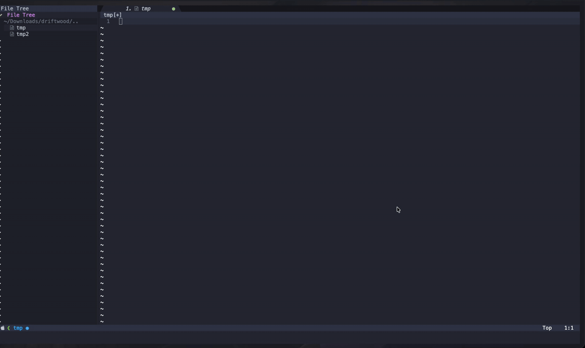

# driftwood.nvim

VSCode-style mouse window handling for Neovim.



Status: early. Tested in Ghostty, directly and inside tmux (`mouse on`). Covers window separators, dragging window titles, dragging files from nvim-tree / bufferline, and the nvim-tree right-click menu.

- **Drag a separator** and the new size sticks, including docks managed by
  [edgy.nvim](https://github.com/folke/edgy.nvim) (which normally snaps them back on the next relayout).
- **Double-click a separator** to restore sizes: edgy docks go back to their configured size,
  ordinary splits are evenly shared between the two windows next to the separator.
- **Drag a window's winbar** onto another window: drop in the middle to swap the two windows'
  buffers and views; drop on the left/right/top/bottom quarter to move the dragged window there as a split.
  A floating highlight shows the drop area while dragging; `<Esc>` cancels. Dropping on itself or on a
  non-file window (terminal, help, ...) does nothing. edgy docks never take part, as source or target.
- **Drag a file from nvim-tree** (or a tab from [bufferline.nvim](https://github.com/akinsho/bufferline.nvim))
  onto an editor window: drop in the middle to open it there, on the left/right/top/bottom quarter to open it in a
  new split on that side. Same highlight and `<Esc>` as above. Folders can't be dragged. Clicks and double-clicks in
  the tree behave as before; it only counts as a file drag once the mouse leaves the tree window.
  A bufferline tab is still switched to on press (bufferline's own click handling), then opened at the drop target.
- **Right-click a file in nvim-tree** and the popup menu gets *Open*, *Open to the Right*, *Open Below* and
  *Open in New Tab* (not shown on folders). They are plain `PopUp` entries toggled by a `MenuPopup` autocmd,
  so entries added by your own config keep working next to them.
- Every other mouse event (click, drag-select, insert-mode click) is passed through untouched.
- edgy.nvim, nvim-tree and bufferline are all optional; without them everything else still works.

## Install

```lua
{ "miyago9267/driftwood.nvim", opts = {} }
```

Requires Neovim 0.10+ with `mouse=a`.

## Options

```lua
require("driftwood").setup({
  integrations = { edgy = true, ["nvim-tree"] = true, bufferline = true },
  -- Give ordinary file windows a filename-only winbar to use as the drag handle.
  -- Off by default: a winbar costs a row per window, and windows that already have
  -- a winbar (yours or another plugin's) are never overwritten.
  winbar = false,
})
```

Dragging only works on windows that have a winbar. The highlight group `DriftwoodDrop`
(default link: `PmenuSel`) colours the drop area.

See `:help driftwood` for details.

## Tests

```
make test
```

## License

MIT
